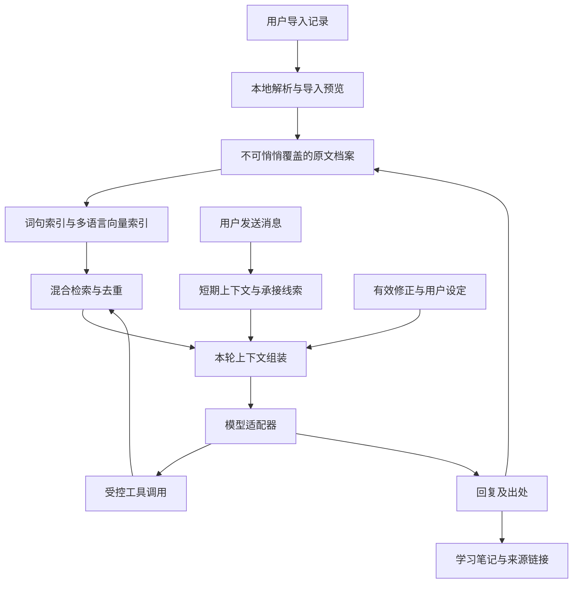

# 工程设计：先理解一条消息走过哪里

## 四类数据不能混成一锅

- 原始记录：原文、原说话人、平台、对话/分支、原始时间与导入时间。永远能回到出处。
- 派生索引：FTS 与 embedding，可删除重建；索引版本变更不能混用不同向量空间。
- 用户治理：明确修正、撤回、权限、称呼、风格偏好、有效时间和来源。修正覆盖解释，不擦掉历史。
- 临时上下文：最近对话、当前话题、工具返回。不是全部都永久升级为用户事实或人格。

建议数据契约：Message(id, conversation_id, branch_id, role, text, source_id, recorded_at, timezone, time_precision, imported_at, provenance)；Correction(id, target, statement, source_message_id, status, valid_from, supersedes)；Observation(id, captured_at, uncertainty, text, expires_for_live_use)；Note(id, source_message_id, excerpt, annotation, revision)。记录时间与事件时间分开存。

## 导入不是把文件丢给模型一次就结束

P1：先提供规范 JSON/JSONL 和有角色标记的 MD；预览说话人、时间与记录数，通过后再写入。
P1.1：实现一个明确版本的 ChatGPT 导出适配器，保留分支和工具节点类型。其他平台逐个增加测试样本。
P2：DOCX 支持标题/角色/颜色映射向导。颜色不是所有用户都通用。扫描 PDF/OCR、未知平台和缺失时间不得标成“成功完整导入”。

每次导入输出：原文件摘要哈希、总记录数、成功数、跳过/失败数、重复候选、缺失角色/时间、分支情况。重复导入应幂等。用户能看到哪些被排除并能撤回整批导入。原文件保留策略及删除联动必须明确。

## 复用现有系统，但不要搬私人身份

先复用 Python/SQLite 和已有浏览器交互思路，拆出小模块；不为展示额外引入第二套 Streamlit 页面或先重写全部前端。新原型是独立服务与独立数据目录，端口由新窗口选择未占用值。

reference_core 是已有逻辑的脱离私人配置版本：
- recall.py：词句候选、语义候选、稀有词加权及倒数排名融合。
- semantic_memory.py：量化 ONNX 编码、96-token 片段/24-token 重叠、哈希增量索引、CPU 有界扫描；不能直接当完整后端运行。
- context_policy.py：普通六条近期消息、承接时扩展、少量原话话题卡、部分日期优先级。
- temporal.py：时间戳解释，未知时区不乱补。

适配器必须实现 STATE、archive()、state_db()、get_paragraph() 等接口及相应表结构。详见源码实际调用，不要把缺少这些对象的模块伪装成可直接启动服务。

模型配置使用能力描述（文本/图片/工具/实时音频、上下文限制、计费来源与核验日期），不能仅凭模型名字猜。先做两个显式 API 适配器，独立上下文/工具协议转换，用户主动切换；自动路由后加。订阅登录桥属于可选私人整合，不复制个人 OAuth 或承诺任何订阅能当通用 API。

本地记忆检索不调用付费 embedding API，但仍消耗服务器资源；发给回答模型的原文会计输入费用。缺失供应商用量不等于零收费。日志区分用户消息、请求、工具轮次和账单来源。

## 当前边界必须保留

时间优先级只作用于候选；不是任意事件时间查询。阈值不是准确率。短上下文与纠正优先策略不保证每次回答服从。这里没有人格微调、全自动人格学习、完整网页操作器或自我部署权。

文献阅读：上传与解析、页码/章节锚点、选择片段讨论；无需每次发送全书。笔记保留出处及版本，与聊天共用记忆入口，但有来源类型。

视频：先做可见的会话开始/结束与设备权限、过期帧丢弃、音频轮次隔离，再接模型。长期只留可删除的观察文字与不确定性；不保存原始帧。只有文字观察时不能保证日后重新确认画面或同一对象身份。切屏后台能力要在实际 iPhone 测试，不能由 PWA 安装成功推断锁屏持续通话。

第一公开版本选择每人自行部署的单用户实例；共享托管、多租户隔离、账户恢复、限流及备份恢复需要另一个工程阶段。密钥留在后端；未经说明不得把全部导入资料发送到供应商。
