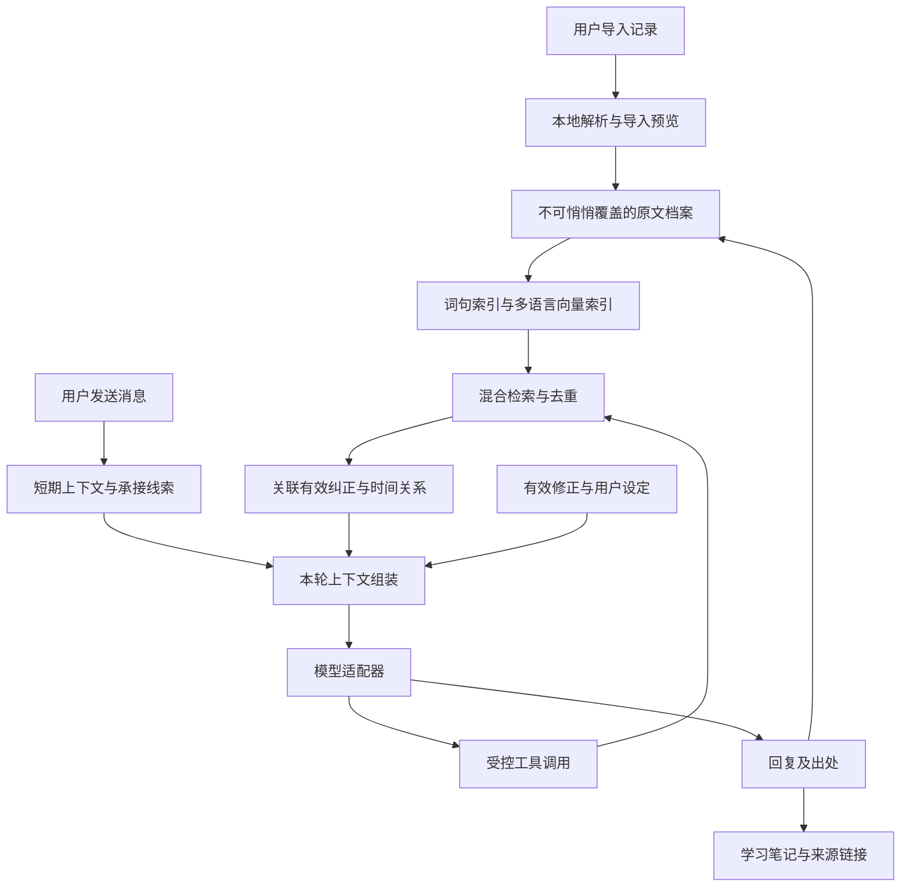

# 工程设计：先理解一条消息走过哪里



## 四类数据不能混成一锅

- 原始记录：原文、原说话人、平台、对话/分支、原始时间与导入时间。永远能回到出处。
- 派生索引：FTS 与 embedding，可删除重建；索引版本变更不能混用不同向量空间。
- 用户治理：明确修正、撤回、权限、称呼、风格偏好、有效时间和来源。修正覆盖解释，不擦掉历史。
- 临时上下文：最近对话、当前话题、工具返回。不是全部都永久升级为用户事实或人格。

### 目标数据契约：时间与纠正

以下是待实现的目标契约，不代表 `reference_core` 已提供同名数据表或完整运行流程。P1-A 的导入格式需保留相应信息，P1-B 再实现时间关系组装与纠正联动；旧样例缺少可选字段不应被伪造补齐。

```text
Message(id, conversation_id, branch_id, role, text, source_id,
        recorded_at, timezone, time_precision, imported_at,
        event_time_note?, provenance)
Correction(id, target, statement, source_message_id, scope,
           target_message_ids, status, valid_from, supersedes)
Observation(id, captured_at, uncertainty, text, expires_for_live_use)
Note(id, source_message_id, excerpt, annotation, revision)
```

**三种时间分开理解、保存：**

| 字段 | 含义与约束 |
|---|---|
| `recorded_at` | 消息实际说出或记录的时间；原始时间精度和已知时区另存，不用导入时间补缺失。 |
| `imported_at` | 记录进入本系统的时间，仅用于导入审计与批次管理，不表示说话或事件发生时间。 |
| `event_time_note`（可选） | 消息中所述事件时间的原文及出处位置，例如“昨天晚上”；保留歧义，缺失时为空，不强行推定日期。事件可能早于或晚于消息本身。 |

检索组装时，用已知记录时间、时区和本轮时间计算并标注相对关系，例如“两条消息在同一天，相隔 3 小时”及“这条记录距本轮 2 天”。“昨天”等事件表达以原消息的时间为参照，不能相对导入时间或本轮时间解释。只有日期精度时不能推算小时差；时区、参照或事件指向不明时标为未知。解析出的事件时间属于有出处、可重建的派生解释，不覆盖原文；当前时间与历史记录的标签分开注入，不能把过去的事写成现在正在发生。

**纠正的作用域与关系：**

- `scope` 只取 `global` 或 `topical`。用户本人明确表达长期要求（如“以后不要这样称呼我”）时自动成为全局常驻偏好；普通事件纠正默认随相关话题生效。引用、转述、假设、反讽或不明确的意图不自动升级为全局偏好。全部纠正均须有可查看的原话出处、作用域和撤回入口。
- `target` 描述被纠正的偏好或事实主题；`target_message_ids` 明确指向受影响的历史 Message，可以为多个，必须保留对话与分支身份。尚未确定关联时保留为空并显示待关联，不能声称已覆盖全部相关旧记录。分块索引须能回到 Message，不能因换分块方式丢失纠正关联。
- `supersedes` 只指向被明确替代的旧 Correction ID，不兼作 Message ID。链须无环；不得跨用户/独立实例关联。`valid_from` 表示纠正何时开始适用，不反过来改写历史消息时间。
- 有效状态按明确替代关系、适用范围、有效时间与撤回记录计算。两个未明确替代、却互相冲突的纠正保留为冲突，向用户呈现，不使用“最后写入者必然正确”。撤回一条纠正后重新计算有效状态并使相关上下文缓存失效；被它替代的旧纠正不自动复活，恢复旧版本需要用户明确选择。

### P1-B：关联纠正后再控制上下文预算

1. 混合检索先产生带出处的历史 Message 候选。
2. 依据 `target_message_ids` 查找适用纠正及其替代链，解析有效状态；这是本地关联查询，无须额外付费模型调用。除历史候选外，本轮使用的近期消息和工具补查原文也经过同一环节。
3. 把历史记录与有效纠正组成不可拆分的证据组。组内先展示当前适用纠正，再给出明确标为历史的原文；未解决冲突连同证据一起呈现。纠正优先覆盖个人偏好、关系定义及用户个人陈述的解释，不改写原件，也不把外部事实争议伪装成已确定。
4. 在关联完成后计算预算。预算不足以容纳一组时，舍弃该旧记录并记录裁剪原因，不保留旧记录而丢掉它的纠正；同一纠正关联多条消息时可去重，但所有保留消息都须能指向它。该约束保证组装器不漏带已关联的纠正，不保证模型一定服从，也不保证尚未关联的同义旧记录都能被发现。
5. 全局有效偏好以稳定顺序置于独立的治理前缀，和系统规则、检索到的档案正文明确分隔；正文不因被检索而升级成指令。前缀带版本，纠正、撤回或冲突状态变化时更新版本。本轮时间和动态召回材料置于其后。稳定前缀为供应商缓存创造条件，具体命中率、有效期和节省金额仍须实测，不能宣称免费或保证命中。

全局前缀也计入输入预算。若它本身已超过可用空间，应明确提示用户整理或调整预算，不静默删除有效偏好，也不把全局规则降成只在某次碰巧召回才生效。上述机制的测试用例与评估须区分“数据契约完整”“组装器行为正确”和“模型回答采纳”，不能用文档或样例通过替代后两项运行证据。

## 导入不是把文件丢给模型一次就结束

P1：先提供规范 JSON/JSONL 和有角色标记的 MD；预览说话人、时间与记录数，通过后再写入。
P1.1：实现一个明确版本的 ChatGPT 导出适配器，保留分支和工具节点类型。其他平台逐个增加测试样本。
P2：DOCX 支持标题/角色/颜色映射向导。颜色不是所有用户都通用。扫描 PDF/OCR、未知平台和缺失时间不得标成“成功完整导入”。

每次导入输出：原文件摘要哈希、总记录数、成功数、跳过/失败数、重复候选、缺失角色/时间、分支情况。重复导入应幂等。用户能看到哪些被排除并能撤回整批导入。原文件保留策略及删除联动必须明确。

## 复用现有系统，但不要搬私人身份

先复用 Python/SQLite 和已有浏览器交互思路，拆出小模块；不为展示额外引入第二套 Streamlit 页面或先重写全部前端。新原型是独立服务与独立数据目录，端口由新窗口选择未占用值。

reference_core 是已有逻辑的脱离私人配置版本：
- recall.py：词句候选、语义候选、稀有词加权及倒数排名融合。
- semantic_memory.py：量化 ONNX 编码、96-token 片段/24-token 重叠、哈希增量索引、CPU 有界扫描；不能直接当完整后端运行。
- context_policy.py：普通六条近期消息、承接时扩展、少量原话话题卡、部分日期优先级。
- temporal.py：时间戳解释，未知时区不乱补。

适配器必须实现 STATE、archive()、state_db()、get_paragraph() 等接口及相应表结构。详见源码实际调用，不要把缺少这些对象的模块伪装成可直接启动服务。

模型配置使用能力描述（文本/图片/工具/实时音频、上下文限制、计费来源与核验日期），不能仅凭模型名字猜。先做两个显式 API 适配器，独立上下文/工具协议转换，用户主动切换；自动路由后加。订阅登录桥属于可选私人整合，不复制个人 OAuth 或承诺任何订阅能当通用 API。

本地记忆检索不调用付费 embedding API，但仍消耗服务器资源；发给回答模型的原文会计输入费用。缺失供应商用量不等于零收费。日志区分用户消息、请求、工具轮次和账单来源。

## 当前边界必须保留

时间优先级只作用于候选；不是任意事件时间查询。阈值不是准确率。短上下文与纠正优先策略不保证每次回答服从。这里没有人格微调、全自动人格学习、完整网页操作器或自我部署权。

文献阅读：上传与解析、页码/章节锚点、选择片段讨论；无需每次发送全书。笔记保留出处及版本，与聊天共用记忆入口，但有来源类型。

视频：先做可见的会话开始/结束与设备权限、过期帧丢弃、音频轮次隔离，再接模型。长期只留可删除的观察文字与不确定性；不保存原始帧。只有文字观察时不能保证日后重新确认画面或同一对象身份。切屏后台能力要在实际 iPhone 测试，不能由 PWA 安装成功推断锁屏持续通话。

第一公开版本选择每人自行部署的单用户实例；共享托管、多租户隔离、账户恢复、限流及备份恢复需要另一个工程阶段。密钥留在后端；未经说明不得把全部导入资料发送到供应商。

## P1-A 实现落点（2026-10-24）

`continuity/` 新增独立的标准库服务、SQLite 原件/出处/字面索引和三屏 UI，不依赖私人后端或 `reference_core` 缺失的适配器。实际规范 JSON/MD 契约、删除边界与操作见 `docs/11-p1a-workbench.md`。此切片不支持 JSONL/原生平台导出，不执行事件时间推断或纠正机制，`reference_core` 的混合召回仍待 P1-B 核验接入。顶层治理扩展与消息原文分开保留，不生成推断事实。
