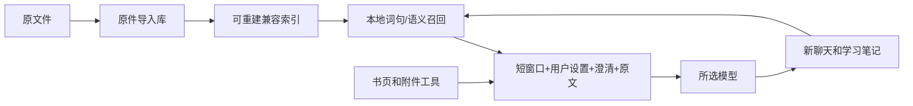

# 从先导应用迁入完整平台

2026-10-25。前次交接把研究切片缩成“先做导入检索”，下一窗口据此实现了没有聊天的绿色工作台。用户要从已有应用提炼完整平台。现在复用净化后的功能代码和灰紫 UI，保留工作台为导入入口，不要求重新开发所有配套功能。

## 功能迁入和验收分开说

| 模块 | 此版本状态 | 验证及剩余工作 |
|---|---|---|
| 聊天/Markdown/模型选择 | 已迁入，默认首页 | 离线两轮工具调用→回复→保存通过；真实 API 未调用 |
| 导入→聊天记忆 | 已接通同一档案 | JSON/MD 原字节、分支隔离、删除与召回合成检查通过；不承诺任意原始导出自动识别 |
| 多语言语义检索 | 可选 CPU 模型 | 四个文件固定哈希；中英俄三个合成查询及删除检查通过；不是质量基准 |
| 澄清与时间地点 | 先导机制迁入，个人种子清空 | 原话保存与撤回可用；新 scope/联动契约待实现 |
| 资料库/附件 | 已迁入 | 文字旧版本、过期编辑阻止通过；复杂文件和图片待更多验收 |
| 阅读器 | PDF.js/foliate 与原交互 | 合成 PDF/EPUB 实际渲染与并排聊天通过；复杂论文/OCR未验收 |
| 学习笔记 | 米色模式与同一检索 | 收藏/批注/撤回检查通过 |
| 联网搜索 | 工具适配器迁入 | 缺密钥默认不可用，未发送搜索请求 |
| 视频 | UI、音频队列、relay 迁入 | 本地 relay 与授权前拒绝检查；未申请设备权限或进行真实通话 |
| 工作室 | 状态、草稿、审计链迁入 | 无自动上线权限，更多工具测试待补 |
| GPT 订阅桥 | 明确显示未配置 | 需独立认证，未读取私人订阅 |
| 手机/桌面 | 响应式 Web UI | 390px 浏览器检查；不是公网部署或原生客户端 |

## 一份记忆如何连起来

原件库保留原始扩展字段、来源和时间精度。兼容层目前使用记录时间与来源分组，不能说 event_time_note 等新契约全部生效。跨库更新不是单一事务，中断后启动会从原件库重建索引；大库性能待测。地点靠明确报告，不是 GPS；相对时间目前沿用北京时间，跨时区配置待补。

所有模型共用独立实例的聊天、笔记、设置和档案。全量原文保存，每轮只发送有限近期上下文与相关证据。向量是派生数据，不取代原件。

## 费用改进的实际范围

用户近期账单属于私人应用。本次未改私人代码、部署或账单。本原型新增每次模型往返的上下文体积记录，关联供应商用量、预估人民币、job_id 和轮次，供后续定位。

只无损移除模型证据 JSON 的空数组、空对象和 null，保留原文、0、false 和时间依据。没有把原文换摘要。字符数不是 token；一次发消息可能有多轮模型请求，免费检索不等于免费把原文给模型阅读。不能宣称私人账单已降低。

后续按每条用户消息汇总初次请求、补查次数、输入、缓存、输出与思考，再评估去重、稳定前缀和零增益查询终止。价格、缓存及节省金额要实际测量，不预告百分比。

## 回退

关闭本地进程即可。旧工作台可单独运行：`python -c "from continuity.server import main; main()"`。代码通过功能分支审阅，私人应用未改动。数据保存在独立 profile。
