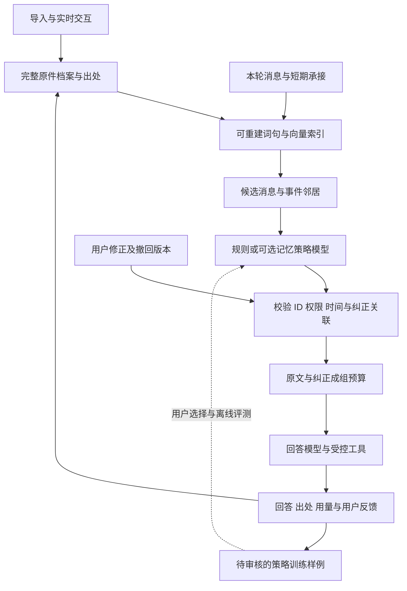

# Stet：可治理的记忆策略与人格连续性

2026-11-17 · 工程提案，不是已实现功能或实验结果。

当前可运行的是完整聊天平台、原件导入、词句/可选本地语义检索、澄清覆盖层、阅读和学习笔记。本文的训练策略、人格分层与纠正联动尚未部署。本轮没有训练、下载新权重、上传聊天或发布 Hugging Face 模型。

## 先把“自己的记忆机制”说准确

推荐的产品定位：**Stet 让每个人拥有可携带、可检查、可修订的记忆档案，并逐步配置适合自己的记忆使用策略。** 已有个体档案，不等于已有每人专属微调模型。个性化先来自自己的档案、明确偏好和检索反馈；有证据表明需要时，才增加私人适配器。

| 层次 | 负责什么 | 是否每人训练 | 状态 |
|---|---|---|---|
| 原件档案 | 聊天、资料、笔记及其出处与时间 | 不需要；每个资料目录隔离 | 已有 |
| 候选检索 | 词句匹配、可选多语言向量召回 | 默认公共编码器，本地计算 | 已有；质量待系统评测 |
| 记忆策略控制器 | 选择查什么、扩展哪段、何时停止；提出派生记忆变更 | 默认规则，后来可选共享模型 | 训练版待实现 |
| 用户专属策略 | 使用经本人审核的反馈调整规则或适配器 | 可选，不是入门门槛 | 待研究 |
| 回答模型 | 读取本轮证据并与用户对话 | 可换供应商；与控制器分开 | 已有适配器；供应商须各自验收 |

存入 RAG 的文字，只有被选入请求时回答模型才能利用。优化目标是少发无关/重复材料，同时保留必要证据及纠正，不能把“存在库里”当成“模型已经知道”。

## 参考工作的真实范围

**Memory-R2** 用同一基座配合不同提示承担提取与管理。LoGo-GRPO 同时利用长轨迹奖励和从相同中间记忆状态重新采样的局部比较，并逐步增加会话长度。它训练的是记忆构建策略，不是每位用户的 embedding 编码器，也没有直接证明人格稳定。[论文 §3](https://arxiv.org/html/2605.21768v1)

作者已经提供基于 Qwen2.5-7B-Instruct 的记忆管理模型，和回答模型分开。可以先做有约束的离线比较，无须先重训一遍。模型卡当前未提供托管推理服务；**上传权重不等于给用户提供可用 API**。[模型卡](https://huggingface.co/ahmedehabb/Memory-R2) 官方训练栈使用 ReMA/verl；不能把一个 Unsloth SFT notebook 宣称为复现完整 LoGo-GRPO。[官方代码](https://github.com/ahmedehabb/Memory-R2)

**Alicia** 的 Listen / Notice / Know 提供即时交互、较慢观察与周期性理解的分层启发。这里借鉴分层与可回读文档，不继承任何删除原件、自动覆盖用户编辑或无证据自述“发现”的路径。公开实现与论文实例不能假定为同一版本；本文参考公开源码 `6cd44b5721b960b3f623de2c4f9096514863555a`，并非已运行完整作者系统。[仓库](https://github.com/mrdaemoni/myalicia)、[画像与关系变化实现](https://github.com/mrdaemoni/myalicia/blob/6cd44b5721b960b3f623de2c4f9096514863555a/myalicia/skills/person_diarization.py)

## 记忆数据流：控制器提议，程序验证



控制器输入是问题、少量近期承接、候选 ID/片段/元数据和剩余预算。输出结构化动作，例如：

```json
{
  "schema": "stet.memory-policy.v1",
  "action": "expand",
  "message_ids": ["synthetic:m12"],
  "neighbors": 2,
  "reason_code": "missing_event_context",
  "confidence": 0.63
}
```

首版动作限 `select / expand / search / abstain / stop`。只允许同一 profile、真实存在的 ID，限制邻居范围与工具次数；拒绝幻造 ID、跨用户访问、代码执行和任意文件路径。超时、无效 JSON、费用超限均退回确定性混合检索；不循环重试。每条回复保留“候选→选中→裁剪→实际发送”的审计计数及策略版本，不记录模型私有思考链。

第二阶段才让控制器提出 `propose_summary / propose_relation / retire_derived`。这些操作只作用于可重建派生层；提案必须引用原消息、说明不确定性。不得直接映射 Memory-R2 的 DELETE 为删除聊天原件。用户删除是独立、可见的治理操作。

时间字段和纠正契约沿用 [02-architecture.md](02-architecture.md)：`recorded_at`、`imported_at`、`event_time_note` 分开；“昨天”相对当时消息解释。先关联有效 `target_message_ids` 纠正，再做预算裁剪。纠正与旧原文不可拆开；没有空间就放弃那条旧记录。`supersedes` 指旧纠正，不能混成消息 ID。引用别人或收藏一段话，不会自动升级成自己的全局偏好。上述联动仍待实现。

## 三条使用路径，普通用户先走第一条

| 路径 | 用户要做什么 | 成本与限制 |
|---|---|---|
| 默认规则 + 本地候选检索 | 导入、检查出处、填写回答模型 API | 无额外策略 API；发送给回答模型的证据仍计费 |
| 共享策略模型或自选 API | 打开可选策略设置，填独立 endpoint/model/key | 增加一次或少量策略请求；服务要能运行相应权重，不能只填 HF 页面网址 |
| 私人 LoRA / 规则偏好 | 审核反馈样例，训练并通过自己的留出测试 | 需要 GPU 时间及维护；先提供规则反馈，数据不足时不强行微调 |

共享策略模型先用明确许可的公共/合成数据及主动授权的数据训练。个人实例不默认上传资料；共享模型发布不携带私人示例、原件、训练缓存或日志。私人适配器也可能记住敏感信息，默认只留在用户控制的运行目录。

训练和日常推理是两件事。Colab 可用于训练试验，但浏览器关闭、配额和运行时回收使它不适合作为默认长期在线服务。普通用户继续用规则检索，或显式选择已部署的策略 API；不要求每次打开 Colab。

### 可实现的 Colab 向导（尚未开发）

1. 在“记忆策略”侧栏查看待审核样例：问题、候选、选择/遗漏、出处、用户纠正，逐条纳入或排除。
2. 本地导出去标识化训练包及清单，分开 train/dev/test；显示会发送什么、交给哪个平台。不会一点击就上传全部聊天。
3. 打开固定版本 notebook，用户自己登录 Google、选择可用 GPU、上传已审核包。第一版用 Unsloth 做小规模 SFT，先学合法动作和证据选择；显存不足就报明要求，不承诺所有免费 GPU 都能跑。
4. 下载适配器、基座 revision、训练配置、许可、数据集哈希和留出评测报告。训练输出不自动发布到 HF。
5. 回到 Stet 导入适配器清单，先在影子模式评测；只有通过结构/隔离/纠正检查并由用户启用，才参与真实检索。一键退回上一策略。

要复现完整 LoGo-GRPO，还需实现可重放记忆状态、同状态局部重采样、全局轨迹奖励、课程长度及多轮优化；这些与 SFT 分开立项。Unsloth 提供的多轮 Agent RL 路线可供实现参考，但不是现成的 Memory-R2 插件。[Unsloth Agent RL 指南](https://unsloth.ai/docs/get-started/reinforcement-learning-rl-guide/training-ai-agents-with-rl)

## 人格形成：稳定的约定与可修订的理解分开

这套层次描述外部记忆和调度方式，不把“反思文档”当成意识或独立人格的证据。

| 层 | Stet 的实现目标 | 写入和使用规则 |
|---|---|---|
| Listen · 当前交互 | 读当前消息、少量近期承接、必要证据，生成回复 | 每轮执行；不为塑造性格附加多轮自评 |
| Notice · 观察草稿 | 记录本次是否误称呼、重复建议、遗漏上下文或表达偏好变化 | 先由明确反馈触发；后台模型分析需用户启用并单独计量；草稿不自动成为事实 |
| Know · 持续理解 | 分开用户自述、Agent 表达约定、关系定义和未解决事项 | 有来源、有版本、显示变更；用户编辑覆盖机器提议；不单向覆盖用户文件 |
| Practice · 实用策略 | 根据任务选择少量表达/协作策略 | 可以全关；默认不并发调用六个模型，不强行套用亲密语气 |

将神话名字替换为六个可理解的策略：

| 策略 | 适用时机 | 约束 |
|---|---|---|
| 倾听 Listener | 用户想表达感受或暂时不需要建议 | 不自动升级亲密关系，不模板化安慰 |
| 核对 Archivist | 指向旧事、人物、时间或纠正 | 有出处才陈述；找不到就承认 |
| 协作 Collaborator | 共同完成具体任务 | 尊重用户选择，给可执行下一步 |
| 质询 Challenger | 论证、研究或高置信度断言需要检查 | 讨论证据，不把不同意当成关系失败 |
| 探索 Explorer | 发散、创作、提出新联系 | 新联系标为猜想，不冒充共同回忆 |
| 回顾 Reflector | 用户希望总结交互变化 | 产出可审核差异，不自行改写关系定义 |

模式由显式需求和轻量规则选择，优先零或一个主模式，必要时两个。记录选择理由和用户反馈；不以聊天时长、黏性或“甜蜜程度”最大化为奖励，不强制均匀轮流用所有模式。用户可编辑名字、强度与触发条件；任何策略都不能覆盖事实诚实与用户治理。

建议新契约：

```text
PersonaEntry(id, kind, statement, source_message_ids,
             authority: user_explicit | model_proposal,
             status: draft | active | revoked, version, valid_from)
PersonaRevision(id, parent_version, changes, evidence_ids,
                actor, reason, created_at, approved_at?)
PolicyRun(id, query_id, candidate_ids, selected_ids, dropped_groups,
          correction_version, persona_version, controller_version,
          model_id, token_usage, cost_status, latency_ms)
```

用户明确的长期要求可按其已选择的规则自动生效，并可查看撤回；推断出来的性格、关系定义和机器自我叙事先作为草稿。冲突显示为冲突，不能只用“最后写入”定胜负。撤回阻止旧纠正自动复活，历史版本保留审计但不继续当作有效规则。

回答模型仍需在请求里收到相关人格约定。可以把短小、稳定且版本化的核心置于前缀，把话题相关约定/表达范例按需召回，不必每次塞入所有画像。缓存是否命中取决于供应商协议与实际回执，不保证免费。换模型后进行同场景回归和用户盲评，不承诺提示词能完全抵消模型差异。

## 先做什么，怎样判断值得继续

| 阶段 | 可交付物 | 放行条件 |
|---|---|---|
| M0：可观察基线 | 固定一组中英俄合成/授权案例与逐轮证据报告 | 时间、角色、分支、撤回与费用口径可复查；不把 14 个规格案例当测试已通过 |
| M1：治理与策略接口 | 纠正联动、分组预算、规则控制器、只读回放 | 无跨用户 ID；有纠正不只发旧文；失败能回退；原件字节不变 |
| M2：共享模型比较 | 作者权重或自选 API 的影子运行 | 相同候选/预算/回答模型下比较召回增益、延迟、总费用；不达标则默认关闭 |
| P1：人格版本 | Notice 草稿、Know 编辑/撤回、六种策略开关 | 用户变更影响后续上下文且可追溯；提示注入不能授权修改人格 |
| M3：训练试验 | SFT notebook、小规模适配器和留出报告 | 不与测试集同事件/同用户泄漏；优于规则基线才提供可选版本 |
| M4：长程 RL | 可重放状态及 LoGo-GRPO 实验 | 与 SFT、无局部重采样、不同轨迹长度消融；资源和收益值得投入 |

每条用户消息汇总所有工具、策略、回答请求的输入/输出、缓存回执、实际/估算/未知费用；同时报告证据 Recall@budget、事件覆盖、错误角色/时间率、纠正遗漏和无证据断言。人格评估分别看风格辨识、边界、事实承接、用户主动改变后的适应；不合成一个未经验证的“人格分数”。

划分训练/测试时按用户、事件及时间边界分组；同一事件的翻译版、相邻窗口、相同纠正链不能两边都有。基线至少包括现有混合检索、规则控制器、共享模型、个性化适配器；回答模型固定后再做模型 × 架构的交叉试验。用户反馈既包含喜欢，也包含错误、遗漏、机械亲密与过度推断，不能只优化好评。

本轮推荐先交付可使用的双语平台，再实施 M0/M1/P1。共享模型与训练入口作为明确标注的后续研究路线，不做不可点击的“专属模型已训练”卖点。

## English overview

Stet separates a user's archive, retrieval indexes, a memory-policy controller, and the answering model. The shipping preview uses the existing retrieval stack; trained controllers, linked correction groups and persona layers are proposals. No personal data or model weights were uploaded for this release.

The proposed controller selects, expands or rejects candidate evidence under deterministic provenance and budget checks. It cannot delete source messages or promote inferred relationship claims into user-authorized rules. A shared policy is optional; per-user adapters are an advanced path with reviewed examples, held-out evaluation and rollback. Publishing weights does not supply a hosted inference service.

Persona continuity is designed as versioned commitments and revisable interpretations: immediate interaction, observation drafts, enduring understanding, and practical modes (Listener, Archivist, Collaborator, Challenger, Explorer, Reflector). Users control the relationship definition. Neither a stable prompt nor a memory policy guarantees stable behavior across model families. Evaluation separates retrieval, correction compliance, interaction style, cost and user-directed change.
